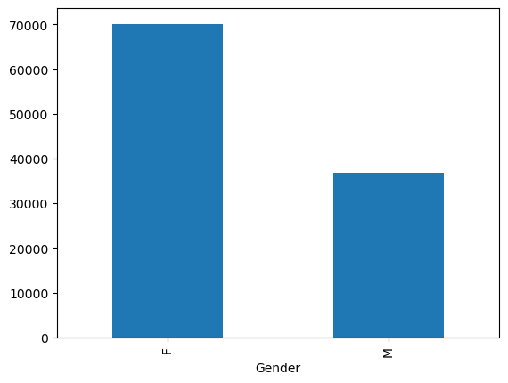
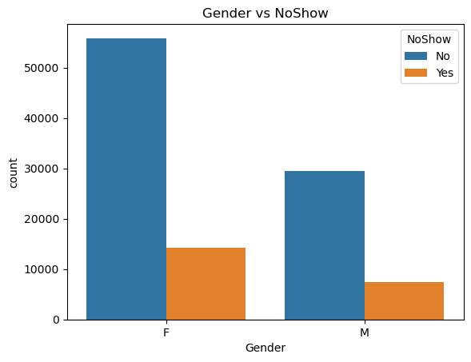
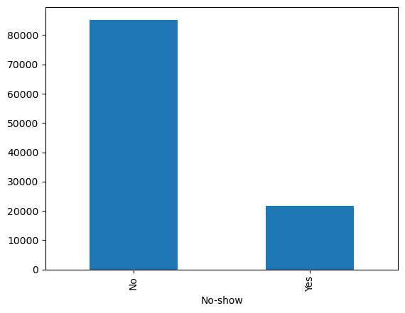
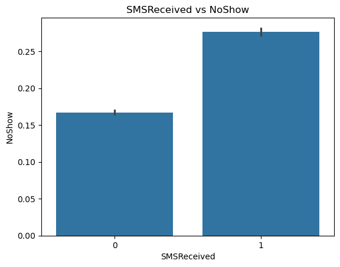
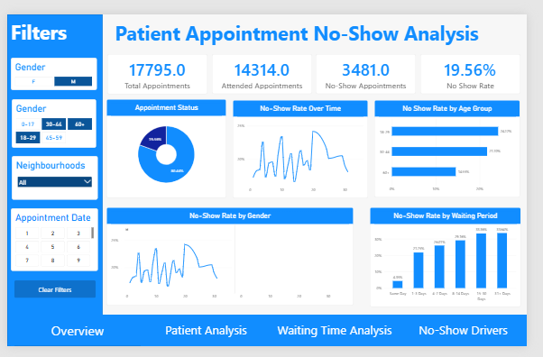
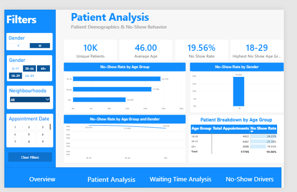
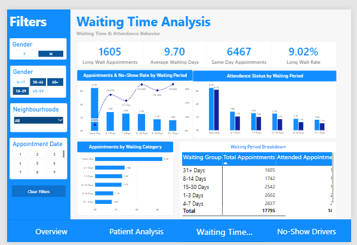
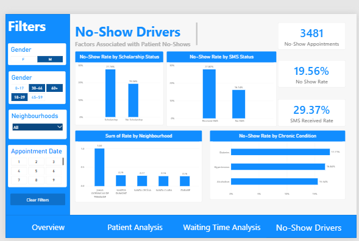

# 🏥 تحليل غياب المرضى عن المواعيد الطبية

## 📌 فكرة المشروع

يهدف هذا المشروع إلى تحليل بيانات مواعيد المرضى لمعرفة الأسباب التي تؤدي إلى عدم حضورهم للموعد الطبي.
تم استخدام التحليل الاستكشافي للبيانات لفهم الأنماط السلوكية والعوامل التي قد تساعد الجهات الصحية على تحسين جدولة المواعيد.

---

## 🎯 هدف التحليل

الإجابة على مجموعة من الأسئلة المهمة مثل:

* هل تؤثر مدة الانتظار بين الحجز والموعد على الحضور؟
* هل تختلف نسبة الغياب حسب يوم الأسبوع؟
* ما الأنماط الظاهرة في بيانات المرضى؟

---

## 🧹 تنظيف وتجهيز البيانات

تم تنفيذ عدة خطوات لتحسين جودة البيانات:

* تحويل أعمدة التواريخ إلى صيغة مناسبة للتحليل
* إنشاء متغير **WaitingDays** لقياس مدة الانتظار
* معالجة القيم غير المنطقية
* تنظيم أسماء الأعمدة

---

## 📊 التحليل الاستكشافي للبيانات

شمل التحليل:

* دراسة توزيع الأعمار
* تحليل تأثير مدة الانتظار
* مقارنة الحضور والغياب عبر أيام الأسبوع
* استخدام الرسومات لفهم الأنماط بشكل بصري

أظهر التحليل أن مدة الانتظار تعتبر من أهم العوامل المرتبطة بعدم حضور المرضى.

---

## 💡 أهم الاستنتاجات

* زيادة مدة الانتظار ترتبط بارتفاع نسبة الغياب.
* بعض أيام الأسبوع تظهر اختلافًا في معدلات الحضور.
* التحليل البصري ساعد على فهم سلوك المرضى بشكل أوضح.

---

## 🛠️ الأدوات المستخدمة

* Python
* Pandas
* Matplotlib
* Seaborn
* Jupyter Notebook

---

### 📊 أمثلة من الرسومات

## 👩‍💻 ماذا تعلمت من المشروع

* تنظيم خطوات تحليل البيانات بشكل واضح.
* تحويل البيانات إلى استنتاجات قابلة للفهم.
* كتابة مشروع تحليل بيانات باللغة العربية.

---

## 📈 لوحة المعلومات التفاعلية باستخدام Power BI

بالإضافة إلى التحليل الاستكشافي باستخدام Python، أعددت لوحة معلومات تفاعلية باستخدام **Power BI** لعرض مؤشرات الحضور وعدم الحضور واستكشاف الأنماط المرتبطة بخصائص المرضى ومدة الانتظار.

تتضمن اللوحة أربع صفحات تحليلية:

### 1. Overview | نظرة عامة

عرض المؤشرات العامة للمواعيد والمرضى، مع متابعة مؤشرات الحضور وعدم الحضور.

### 2. Patient Analysis | تحليل المرضى

استكشاف بيانات المرضى ومقارنة أنماط الحضور وعدم الحضور حسب الخصائص الديموغرافية.

### 3. Waiting Time Analysis | تحليل مدة الانتظار

دراسة فترات الانتظار بين الحجز والموعد واستكشاف علاقتها بعدم الحضور.

### 4. No-Show Drivers | العوامل المرتبطة بعدم الحضور

عرض مقارنات بصرية تساعد على تحديد الفئات والأنماط التي تحتاج إلى متابعة وتحليل أعمق.

### 💡 استنتاجات لوحة Power BI | Dashboard Insights

تساعد صفحات التقرير على قراءة مؤشرات عدم الحضور من زوايا مختلفة، وليس الاكتفاء بإجمالي المواعيد. وفيما يلي أبرز الملاحظات التحليلية التي يمكن عرضها مع الداشبورد:

* **اختلاف المخاطر حسب العمر:** في التحليل السابق للمشروع ظهرت الفئة العمرية **18–29 عامًا** بوصفها الأعلى في نسبة عدم الحضور ضمن الفئات المعروضة. يجب تأكيد النتيجة من البيانات المعروضة بعد إزالة الفلاتر قبل اعتمادها في التقرير النهائي.
* **أهمية مدة الانتظار:** أظهر التحليل الاستكشافي باستخدام Python ارتباطًا بين زيادة مدة الانتظار وارتفاع الغياب. وتوفر صفحة **Waiting Time Analysis** وسيلة لمقارنة معدلات عدم الحضور بين فترات الانتظار، والتحقق من استمرار النمط عند تطبيق التصفية.
* **اختلاف نسب الغياب بين الأحياء:** تتيح صفحة **No-Show Drivers** مقارنة الأحياء وتحديد الأعلى **كنسبة** من مواعيدها، بدل الاعتماد على العدد المطلق للغياب، الذي قد يتأثر بحجم المواعيد في كل حي.
* **مؤشرات قابلة للمتابعة:** تجمع صفحة **Overview** مؤشرات الحضور والمرضى والمواعيد ذات الانتظار الطويل، مما يساعد على مراقبة المشكلة بصورة شاملة.

> **دقة الاستنتاجات:** هذه خلاصة تحليلية وصفية بناءً على محاور المشروع ونتائج سبق تناولها، وليست إثباتًا رقميًا مستقلًا لجميع المخططات. يجب مراجعة القيم في صور Power BI قبل نشر نسب محددة أو الجزم بترتيب الأحياء والفئات.

### 🎯 توصيات مقترحة للإدارة | Recommendations

1. **مراجعة المواعيد ذات الانتظار الطويل:** إذا استمر ارتفاع معدل الغياب فيها، يمكن تجربة تأكيد الموعد مبكرًا أو توفير مواعيد بديلة، وقياس الأثر بعد التطبيق.
2. **توجيه التذكير بصورة أدق:** اختبار رسائل التذكير للمجموعات ذات المعدلات الأعلى، مع مقارنة نسب الحضور قبل التدخل وبعده؛ لا يمكن افتراض فعالية الرسائل من مجرد وجودها في البيانات.
3. **متابعة المؤشرات حسب الفئة والحي:** استخدام معدل عدم الحضور ونطاق حجم العينة معًا قبل تحديد أولويات التدخل.
4. **قياس نجاح التحسين:** متابعة معدل عدم الحضور بمرور الوقت، ومقارنة النتائج بعد أي تغيير في جدولة المواعيد أو أسلوب التذكير.

---

### 🛠️ أدوات لوحة المعلومات

* **Power BI:** تصميم التقرير والمخططات التفاعلية.
* **Power Query:** تجهيز البيانات وتحويلها.
* **DAX:** بناء المقاييس ومؤشرات الأداء (KPIs).
* **Slicers:** تصفية البيانات والتفاعل مع المخططات.

### 📁 ملف Power BI

يمكن العثور على ملف المشروع القابل للفتح في Power BI Desktop داخل المستودع:

[فتح ملف NO-SHOW.pbix](NO-SHOW.pbix)

> **ملاحظة:** يعتمد التحليل على دراسة العلاقات والأنماط في البيانات؛ الارتباط الإحصائي لا يثبت وحده أن أحد العوامل يسبب عدم الحضور.
